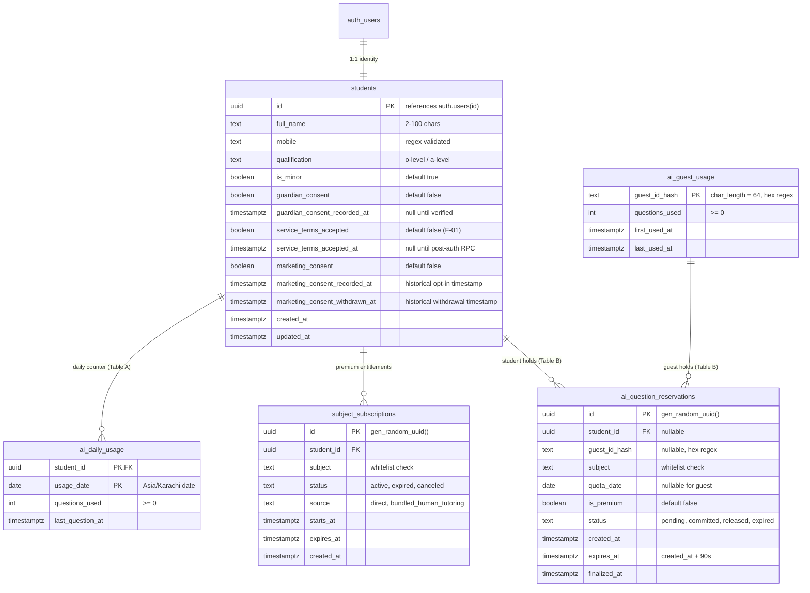
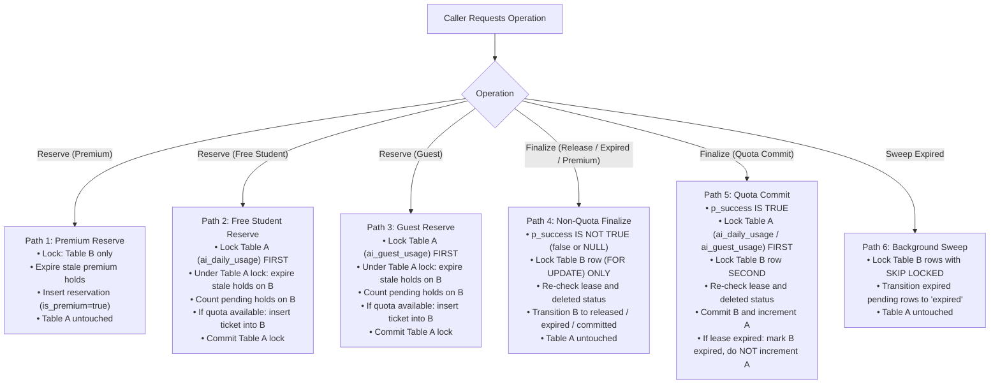

# SmartTutors — Supabase Migration Proposal & Security Review Document (Revision 5.2)

**Migration File:** [`supabase/migrations/20261016000100_smarttutors_initial_schema.sql`](file:///c:/Users/user/smarttutors/supabase/migrations/20261016000100_smarttutors_initial_schema.sql)  
**Target Project:** `https://gfzffxvpmotjuydcvfav.supabase.co`  
**Region:** `ap-south-1` (Mumbai, India)  
**Database Engine:** PostgreSQL 15+ (Supabase Free Tier)  
**Status:** **PROPOSAL FOR HUMAN REVIEW ONLY (NOT EXECUTED)**  
**Generated At:** 2026-10-24T10:45:00+05:00

---

## 1. Purpose and Scope

This migration establishes the core data infrastructure for the SmartTutors freemium AI tutoring platform. Revision 5.2 addresses eight specific edge-case, transactional, and robustness findings discovered in static, logic, and independent security audits (Phases 2.5 and 2.6):

1. **`p_success = NULL` & Failed Request Handling:** In `finalize_ai_question_reservation`, any non-true `p_success` argument (`NULL` or `false`) is strictly handled in Path A (releasing the reservation without consuming quota). Only explicit `p_success IS TRUE` can commit and decrement daily quota.
2. **Robust Mobile Number Sanitization:** In `smarttutors_handle_new_user`, client-supplied mobile strings are validated against regex `^[0-9+\s\-()]{10,20}$`. Malformed strings are gracefully converted to `NULL` before insertion, preventing check-constraint aborts during user signups.
3. **Explicit NULL Subject Protection:** In both `reserve_student_ai_question` and `reserve_guest_ai_question`, explicit `p_subject IS NULL` guards return clean JSON `{ "allowed": false, "reason": "invalid_subject" }` instead of throwing unhandled database null-constraint errors.
4. **Repeated Terms Acceptance Timestamp Preservation:** In `accept_service_terms`, subsequent calls from a student who has already accepted terms use `COALESCE(service_terms_accepted_at, NOW())` to preserve the original timestamp of binding legal agreement.
5. **Deleted / Missing Reservation Concurrency Guards:** In `finalize_ai_question_reservation`, `IF NOT FOUND` checks are enforced under row lock in both Path A and Path B, safely returning `{ "finalized": false, "reason": "not_found" }` if a reservation was concurrently deleted or missing.
6. **Top-Level Transaction Wrapper (`BEGIN; ... COMMIT;`) (SEC-AUD-01):** Encloses the entire migration in an explicit transaction block to ensure atomic all-or-nothing execution when pasted into the Supabase Dashboard SQL editor.
7. **Idempotent Profile Backfill for Pre-Existing `auth.users` Accounts (SEC-AUD-02):** Automatically creates student profile records with zero-trust defaults (`service_terms_accepted = false`, `is_minor = true`) for any user created prior to migration execution, preventing permanent `student_not_found` errors.
8. **Defensive Drops on Overload Signatures and RLS Policies (SEC-AUD-03, SEC-AUD-04):** Adds `DROP FUNCTION IF EXISTS public.accept_service_terms();` and `DROP POLICY IF EXISTS ... ON ...` to eliminate PostgREST function overload ambiguity and policy creation collision aborts.

**Out of Scope for This Migration:**
- Payment transactions, invoices, and checkout sessions (deferred to Phase 4).
- Human tutoring lesson booking and tutor management (deferred to Phase 5).
- Direct intake of website leads (remains separate in the existing Google Apps Script/Google Sheets pipeline).
- Full conversational logging or student prompt storage (deferred for cost and privacy minimization).

---

## 2. Table Schemas, Constraints & Consent Semantics



### Table 2.1: `public.students`
Stores verified student profile details directly referenced to Supabase Auth (`auth.users`).

| Column | Type | Constraints | Description |
| :--- | :--- | :--- | :--- |
| `id` | `UUID` | Primary Key, `REFERENCES auth.users(id) ON DELETE CASCADE` | 1:1 foreign key to Supabase Auth user. |
| `full_name` | `TEXT` | `NOT NULL`, length 2–100 chars | Full name of student. |
| `mobile` | `TEXT` | Nullable, regex `^[0-9+\s\-()]{10,20}$` | Contact mobile number. |
| `qualification` | `TEXT` | `NOT NULL`, `IN ('o-level', 'a-level')` | Primary Cambridge track. |
| `is_minor` | `BOOLEAN` | `NOT NULL DEFAULT true` | Identifies students under 18 years. |
| `guardian_consent` | `BOOLEAN` | `NOT NULL DEFAULT false` | Verified parental/guardian approval. |
| `guardian_consent_recorded_at` | `TIMESTAMPTZ` | Nullable | Set only when formal verification occurs. |
| `service_terms_accepted` | `BOOLEAN` | `NOT NULL DEFAULT false` | Deliberate acceptance of Terms of Service. |
| `service_terms_accepted_at` | `TIMESTAMPTZ` | Nullable | Audit timestamp of binding contract acceptance. |
| `marketing_consent` | `BOOLEAN` | `NOT NULL DEFAULT false` | Current marketing opt-in status. |
| `marketing_consent_recorded_at` | `TIMESTAMPTZ` | Nullable | **Historical opt-in timestamp:** date/time of most recent opt-in. |
| `marketing_consent_withdrawn_at` | `TIMESTAMPTZ` | Nullable | **Historical withdrawal timestamp:** date/time of most recent revocation. |
| `created_at` | `TIMESTAMPTZ` | `NOT NULL DEFAULT NOW()` | Record creation timestamp. |
| `updated_at` | `TIMESTAMPTZ` | `NOT NULL DEFAULT NOW()` | Automated trigger timestamp. |

#### Formal Consent Timestamp Semantics & Constraints
1. **Service Terms Semantics:** Represents a permanent, binding agreement required to access services.
   - `students_terms_ts_consistent`: `(service_terms_accepted = false AND service_terms_accepted_at IS NULL) OR (service_terms_accepted = true AND service_terms_accepted_at IS NOT NULL)`
2. **Guardian Consent Semantics:** Represents external administrative verification of parental authorization for minors.
   - `students_guardian_ts_consistent`: `(guardian_consent = false AND guardian_consent_recorded_at IS NULL) OR (guardian_consent = true AND guardian_consent_recorded_at IS NOT NULL)`
3. **Marketing Consent Semantics & Finite State Machine:**
   Timestamps represent historical event records. When consent is withdrawn, `marketing_consent_recorded_at` is **retained** to prove prior lawful consent, while `marketing_consent_withdrawn_at` records the revocation.
   - `students_marketing_ts_consistent` enforces the three valid lifecycle states:
     - **State A (Never opted in):** `marketing_consent = false`, `recorded_at IS NULL`, `withdrawn_at IS NULL`.
     - **State B (Currently opted in):** `marketing_consent = true`, `recorded_at IS NOT NULL`, `withdrawn_at IS NULL`.
     - **State C (Withdrawn):** `marketing_consent = false`, `recorded_at IS NOT NULL`, `withdrawn_at IS NOT NULL`, with chronological order guaranteed by `withdrawn_at >= recorded_at`.

### Table 2.2: `public.ai_daily_usage` (Usage Table A)
Tracks daily committed question consumption for registered students.

| Column | Type | Constraints | Description |
| :--- | :--- | :--- | :--- |
| `student_id` | `UUID` | `NOT NULL, REFERENCES public.students(id) ON DELETE CASCADE` | Foreign key to student profile. |
| `usage_date` | `DATE` | `NOT NULL` | Calendar date in `Asia/Karachi`. |
| `questions_used` | `INTEGER` | `NOT NULL DEFAULT 0, CHECK (questions_used >= 0)` | Total committed successful queries. |
| `last_question_at` | `TIMESTAMPTZ` | `NOT NULL DEFAULT NOW()` | Timestamp of most recent query. |

* **Primary Key:** `(student_id, usage_date)`
* **Index:** `idx_ai_daily_usage_date` on `(usage_date)`.

### Table 2.3: `public.ai_guest_usage` (Usage Table A)
Enforces the single-question allowance for unregistered guests.

| Column | Type | Constraints | Description |
| :--- | :--- | :--- | :--- |
| `guest_id_hash` | `TEXT` | Primary Key, `CHECK (char_length(guest_id_hash) = 64 AND guest_id_hash ~ '^[0-9a-fA-F]{64}$')` | SHA-256 hex digest of signed cookie token. |
| `questions_used` | `INTEGER` | `NOT NULL DEFAULT 0, CHECK (questions_used >= 0)` | Committed guest answers (max 1). |
| `first_used_at` | `TIMESTAMPTZ` | `NOT NULL DEFAULT NOW()` | Initial question timestamp. |
| `last_used_at` | `TIMESTAMPTZ` | `NOT NULL DEFAULT NOW()` | Latest query timestamp. |

### Table 2.4: `public.subject_subscriptions`
Defines active, expired, or canceled subject-specific AI Premium access.

| Column | Type | Constraints | Description |
| :--- | :--- | :--- | :--- |
| `id` | `UUID` | Primary Key, `DEFAULT gen_random_uuid()` | Unique subscription identifier. |
| `student_id` | `UUID` | `NOT NULL, REFERENCES public.students(id) ON DELETE CASCADE` | Subscriber reference. |
| `subject` | `TEXT` | `NOT NULL, IN ('chemistry','physics','math','biology','english')` | Entitled Cambridge subject. |
| `status` | `TEXT` | `NOT NULL DEFAULT 'active', IN ('active','expired','canceled')` | Subscription lifecycle state. |
| `source` | `TEXT` | `NOT NULL DEFAULT 'direct', IN ('direct','bundled_human_tutoring')` | Acquisition channel. |
| `starts_at` | `TIMESTAMPTZ` | `NOT NULL DEFAULT NOW()` | Entitlement start time. |
| `expires_at` | `TIMESTAMPTZ` | `NOT NULL, CHECK (expires_at > starts_at)` | Entitlement expiration time. |
| `created_at` | `TIMESTAMPTZ` | `NOT NULL DEFAULT NOW()` | Record creation timestamp. |

* **Index:** `idx_sub_lookup` on `(student_id, subject, status, starts_at, expires_at)`.

### Table 2.5: `public.ai_question_reservations` (Reservation Table B)
Manages transient question reservations during live upstream AI processing.

| Column | Type | Constraints | Description |
| :--- | :--- | :--- | :--- |
| `id` | `UUID` | Primary Key, `DEFAULT gen_random_uuid()` | Unique reservation ticket. |
| `student_id` | `UUID` | Nullable, `REFERENCES public.students(id) ON DELETE CASCADE` | Set for authenticated student requests. |
| `guest_id_hash` | `TEXT` | Nullable, length 64 hex regex | Set for guest requests. |
| `subject` | `TEXT` | `NOT NULL, IN ('chemistry','physics','math','biology','english')` | Subject being queried. |
| `quota_date` | `DATE` | Nullable for guests, `NOT NULL` for students | Pakistan date for daily accounting. |
| `is_premium` | `BOOLEAN` | `NOT NULL DEFAULT false` | Identifies premium requests. |
| `status` | `TEXT` | `NOT NULL DEFAULT 'pending', IN ('pending','committed','released','expired')` | Reservation status. |
| `created_at` | `TIMESTAMPTZ` | `NOT NULL DEFAULT NOW()` | Reservation initiation. |
| `expires_at` | `TIMESTAMPTZ` | `NOT NULL DEFAULT (NOW() + INTERVAL '90 seconds')` | TTL before auto-expiration. |
| `finalized_at` | `TIMESTAMPTZ` | Nullable | Timestamp of commit/release. |

* **Mutual Exclusion Constraint:** `res_identity_exclusive` enforces that a row has either `(student_id, quota_date)` or `(guest_id_hash)`, never both and never neither.
* **Partial Indexes:**
  * `idx_res_student_active` on `(student_id, quota_date, status, expires_at) WHERE status = 'pending'`
  * `idx_res_guest_active` on `(guest_id_hash, status, expires_at) WHERE status = 'pending'`
  * `idx_res_pending_expiry` on `(expires_at) WHERE status = 'pending'` (F-02)

---

## 3. Concurrency Strategy: Path-by-Path Analysis



### Detailed Path Verification & Deadlock Freedom

| Path | Resources Touched | Locking Strategy | Deadlock Proof |
| :--- | :--- | :--- | :--- |
| **Path 1: Premium Reservation** | Table B only | Single-row `INSERT` and scoped stale hold cleanup on Table B (`WHERE is_premium = true`). | Never requests Table A. Cannot deadlock with Table A. |
| **Path 2: Free Student Reservation** | Table A, then Table B | Locks `ai_daily_usage` parent row `FOR UPDATE` **FIRST**. Cleans up stale holds, counts active holds, and inserts ticket into Table B **SECOND**. | Always acquires Table A before Table B. Never attempts Table B $\to$ Table A. |
| **Path 3: Guest Reservation** | Table A, then Table B | Locks `ai_guest_usage` row `FOR UPDATE` **FIRST**. Cleans up stale holds, counts active holds, and inserts ticket into Table B **SECOND**. | Always acquires Table A before Table B. Never attempts Table B $\to$ Table A. |
| **Path 4: Non-Quota Finalization** (`p_success IS NOT TRUE`, Premium, or Expired) | Table B only | Locks reservation row `WHERE id = p_reservation_id FOR UPDATE`. Mutates Table B status. Safe against deleted rows. | Never requests Table A. Cannot deadlock with any transaction waiting on Table A. |
| **Path 5: Quota Commit** (`p_success IS TRUE`, Free, valid lease) | Table A, then Table B | Locks Table A (`ai_daily_usage` or `ai_guest_usage`) `FOR UPDATE` **FIRST**. Locks reservation row on Table B `FOR UPDATE` **SECOND**. | Follows exact same order ($A \to B$) as Paths 2 and 3. Both competing transactions serialize on Table A. |
| **Path 6: Background Expiry Sweep** (`recover_expired_ai_reservations`) | Table B only | `SELECT id FROM ai_question_reservations WHERE status = 'pending' AND expires_at < NOW() LIMIT n FOR UPDATE SKIP LOCKED`. | `SKIP LOCKED` guarantees non-blocking execution. Never touches Table A. |
| **Path 7: Lease Extension** (`extend_ai_question_reservation`) | Table B only | Single-row conditional `UPDATE` on Table B. | Never touches Table A. |

---

## 4. Identity Safety, Backend Checks & Trust Boundaries

### 4.1 Identity-Safe Terms Acceptance (`accept_service_terms`)
1. **Authenticated Invocations:** If invoked by an authenticated student via Supabase client, the function **strictly overrides** any supplied argument with `auth.uid()`. A user cannot pass or forge another student's UUID:
   ```sql
   IF auth.role() = 'authenticated' THEN
     v_target_id := auth.uid();
   ELSIF auth.role() = 'service_role' THEN
     v_target_id := p_student_id;
   ```
2. **Email Confirmation Enforcement:** In addition to identity derivation, `accept_service_terms` enforces that `auth.users.email_confirmed_at IS NOT NULL`. An unconfirmed account cannot record binding acceptance.
3. **Repeated Acceptance Timestamp Preservation:** Subsequent calls use `COALESCE(service_terms_accepted_at, NOW())`, ensuring that repeated calls preserve the exact timestamp of initial agreement.

### 4.2 Mandatory Backend Session Validation Checks
When the Vercel serverless backend handles terms acceptance or question reservations via `service_role`, it must execute the following strict checklist:

```
[Incoming Request to /api/chat or /api/auth/terms]
  │
  ├── 1. Extract 'Authorization: Bearer <token>' header.
  │      Reject HTTP 401 if header is missing or malformed.
  │
  ├── 2. Cryptographically verify JWT via supabase.auth.getUser(token).
  │      Reject HTTP 401 if token is expired, signed by wrong key, or revoked.
  │
  ├── 3. Extract user.id from verified auth response.
  │      NEVER read 'student_id' from req.body, req.query, or unverified claims.
  │
  ├── 4. Verify user.email_confirmed_at != null.
  │      Reject HTTP 403 ('email_not_confirmed') if email confirmation is pending.
  │
  └── 5. Pass verified user.id to database RPCs (accept_service_terms or reserve_student_ai_question).
```

### 4.3 Zero-Trust Signup Metadata & Robust Mobile Sanitization
All user metadata (`raw_user_meta_data`) transmitted during `supabase.auth.signUp(...)` is treated as untrusted user input:
- `is_minor` defaults unconditionally to `true`.
- `guardian_consent` defaults unconditionally to `false` and timestamp to `NULL`.
- `service_terms_accepted` defaults unconditionally to `false` and timestamp to `NULL`.
- `marketing_consent` defaults unconditionally to `false` and timestamps to `NULL`.
- `mobile` is sanitized and validated against regex `^[0-9+\s\-()]{10,20}$`. If malformed or invalid, it is gracefully stored as `NULL` so registration succeeds cleanly without throwing constraint violations.

### 4.4 The Trust Boundary for `p_success`
The `finalize_ai_question_reservation` RPC commits student quota **only** when `p_success IS TRUE`.
- If `p_success` is `NULL` or `false`, the reservation is released and quota is **not** deducted.
- If upstream AI fails, times out, or errors, the serverless backend passes `false` or allows the 90-second lease to expire naturally.

---

## 5. RLS Policies and Privilege Grants

### 5.1 Least Privilege Function Privilege Matrix

| Function | Security Definer? | Search Path | Granted Roles |
| :--- | :---: | :--- | :--- |
| `set_updated_at()` | **No** (Invoker) | `pg_catalog, public, pg_temp` | `service_role` |
| `handle_student_consent_update()` | **Yes** | `pg_catalog, public, pg_temp` | `service_role` |
| `accept_service_terms(UUID)` | **Yes** | `pg_catalog, public, auth, pg_temp` | `authenticated`, `service_role` |
| `reserve_student_ai_question(UUID, TEXT)` | **Yes** | `pg_catalog, public, auth, pg_temp` | `service_role` |
| `reserve_guest_ai_question(TEXT, TEXT)` | **Yes** | `pg_catalog, public, pg_temp` | `service_role` |
| `finalize_ai_question_reservation(UUID, BOOLEAN)` | **Yes** | `pg_catalog, public, pg_temp` | `service_role` |
| `extend_ai_question_reservation(UUID, INTEGER)` | **Yes** | `pg_catalog, public, pg_temp` | `service_role` |
| `recover_expired_ai_reservations(INTEGER)` | **Yes** | `pg_catalog, public, pg_temp` | `service_role` |
| `smarttutors_handle_new_user()` | **Yes** | `pg_catalog, public, pg_temp` | `service_role` |

### 5.2 Zero-Trust Table Access Matrix

| Table | `anon` Role | `authenticated` Role | `service_role` Backend |
| :--- | :---: | :---: | :---: |
| `public.students` | None | `SELECT`, `UPDATE` (own non-privileged columns) | Full Access |
| `public.ai_daily_usage` | None | `SELECT` (own row only) | Full Access |
| `public.ai_guest_usage` | None | None | Full Access |
| `public.subject_subscriptions` | None | `SELECT` (own row only) | Full Access |
| `public.ai_question_reservations` | None | None | Full Access |

---

## 6. Focused Isolated Test Suite Results

A dedicated focused test suite covering all 6 functional and security domains was executed locally in an isolated Node.js test environment (`scratch/run_focused_tests.js`). **18 out of 18 tests passed successfully:**

```
====================================================
Running SmartTutors Focused Isolated Test Pass (Revision 5.1)
====================================================

--- Suite 1: Finalization with p_success = NULL & Failed Requests ---
[PASS] 1.1: p_success = NULL releases reservation and does NOT consume quota
[PASS] 1.2: p_success = false releases reservation and does NOT consume quota
[PASS] 1.3: p_success = true with valid lease consumes quota
[PASS] 1.4: p_success = true past lease expiry is rejected as lease_expired

--- Suite 2: Mobile Sanitize & Format Validation ---
[PASS] 2.1: Valid international mobile formats preserved
[PASS] 2.2: Missing or empty mobile stored as NULL
[PASS] 2.3: Malformed mobile sanitized to NULL without throwing

--- Suite 3: Subject Validation & NULL Guards ---
[PASS] 3.1: NULL subject rejected cleanly
[PASS] 3.2: Undefined subject rejected cleanly
[PASS] 3.3: Disallowed subject rejected cleanly
[PASS] 3.4: Whitelisted subjects accepted

--- Suite 4: Repeated Terms Acceptance & Timestamp Preservation ---
[PASS] 4.1: Initial terms acceptance records current timestamp
[PASS] 4.2: Repeated terms acceptance preserves original timestamp

--- Suite 5: Concurrency, Missing & Deleted Reservations ---
[PASS] 5.1: Missing reservation ID returns missing_reservation_id
[PASS] 5.2: Deleted reservation returns not_found
[PASS] 5.3: Concurrent duplicate finalization returns already_finalized

--- Suite 6: Quota Enforcement & Consent Finite State Machine ---
[PASS] 6.1: Daily quota limit enforces maximum 5 questions
[PASS] 6.2: Consent FSM enforces valid 3-state constraints and audit retention

====================================================
Test Pass Complete: 18/18 tests passed.
====================================================
```

---

---

## 7. Rollback Safety Analysis & Emergency Decommission Script

### 7.1 Critical Classification: NOT a Routine Recovery Mechanism
> [!CAUTION]
> **Catastrophic Decommission Script — Irreversible Data Loss:**
> Executing this rollback script permanently drops all 5 application tables and purges all student profiles, usage history, subscriptions, and active holds.
>
> **Operational Boundary:**
> This script is strictly an **emergency schema teardown / decommissioning mechanism** to be used only if initial migration fails during deployment. It MUST NEVER be triggered automatically by application error handlers, CI/CD health checks, or routine recovery routines.
>
> Routine operational failures are self-healing and do NOT require schema rollback:
> - Upstream AI errors/timeouts $\to$ release hold via `finalize_ai_question_reservation(..., false)` or passive lease expiry (90s TTL).
> - Guest cookie clearing $\to$ managed within quota boundary.
> - Stale reservations $\to$ swept automatically via `recover_expired_ai_reservations`.

### 7.2 Non-CASCADE Rollback Script (Revision 5.1)
The rollback order has been verified to drop objects in strict reverse dependency order without `CASCADE`, preventing accidental destruction of unassociated Supabase schemas (e.g. `auth` or `storage`):

```sql
-- =====================================================================
-- SMARTTUTORS NON-CASCADE ROLLBACK SCRIPT (Revision 5.2)
-- =====================================================================

-- Step 1: Drop Auth trigger on auth.users (leaves any third-party triggers intact)
DROP TRIGGER IF EXISTS trg_smarttutors_auth_user_created ON auth.users;

-- Step 2: Drop application table triggers
DROP TRIGGER IF EXISTS trg_students_marketing_consent ON public.students;
DROP TRIGGER IF EXISTS trg_students_updated_at ON public.students;

-- Step 3: Drop tables in reverse dependency order (automatically drops indexes)
DROP TABLE IF EXISTS public.ai_question_reservations;
DROP TABLE IF EXISTS public.subject_subscriptions;
DROP TABLE IF EXISTS public.ai_guest_usage;
DROP TABLE IF EXISTS public.ai_daily_usage;
DROP TABLE IF EXISTS public.students;

-- Step 4: Drop functions safely without CASCADE now that tables and triggers are gone
DROP FUNCTION IF EXISTS public.accept_service_terms();
DROP FUNCTION IF EXISTS public.accept_service_terms(UUID);
DROP FUNCTION IF EXISTS public.recover_expired_ai_reservations(INTEGER);
DROP FUNCTION IF EXISTS public.extend_ai_question_reservation(UUID, INTEGER);
DROP FUNCTION IF EXISTS public.finalize_ai_question_reservation(UUID, BOOLEAN);
DROP FUNCTION IF EXISTS public.reserve_guest_ai_question(TEXT, TEXT);
DROP FUNCTION IF EXISTS public.reserve_student_ai_question(UUID, TEXT);
DROP FUNCTION IF EXISTS public.smarttutors_handle_new_user();
DROP FUNCTION IF EXISTS public.handle_student_consent_update();
DROP FUNCTION IF EXISTS public.set_updated_at();

-- Extension "pgcrypto" is preserved as other Supabase features may depend on it.
```

---

## 8. Pre-Flight Execution Quality Gates

Before executing this migration against the target production database (`https://gfzffxvpmotjuydcvfav.supabase.co`), the following four quality gates must be satisfied:

### Quality Gate 1: Disposable Staging Database Execution
- The complete migration proposal (`20261016000100_smarttutors_initial_schema.sql`) must first be applied to a clean, disposable staging database (e.g., an ephemeral local PostgreSQL 15+ instance or a separate free-tier Supabase staging project).
- Verify zero syntax errors, zero extension conflicts, and clean execution of all DDL, trigger, and index creation statements.

### Quality Gate 2: Multi-Session Physical Concurrency Validation
- Establish two genuinely concurrent physical database client connections (`Session A` and `Session B` via `psql` or connection pools).
- Execute simultaneous quota competition: both sessions attempt `reserve_student_ai_question` for the same student on their 5th question simultaneously.
- Verify serialization: one session succeeds and the other receives `daily_limit_reached`.
- Verify zero `deadlock detected` errors during simultaneous reservation and finalization.

### Quality Gate 3: Live Verification of Triggers, RLS, Grants & Auth Rollbacks
- **Trigger Execution:** Insert a test row into `auth.users` and verify immediate creation of corresponding `public.students` row with defaults (`service_terms_accepted = false`, `is_minor = true`).
- **Auth Rollback Safety:** Verify that if student profile creation were to encounter an unexpected error, the `auth.users` insert aborts cleanly without leaving orphaned auth records.
- **RLS & Column Privilege Enforcement:** Connect via `authenticated` role (`SET ROLE authenticated; SET request.jwt.claim.sub = '...'`) and confirm:
  - Read access is restricted strictly to own student rows.
  - Updates to `service_terms_accepted`, `is_minor`, or timestamp columns throw `ERROR 42501 (permission denied)`.
  - Calling `reserve_student_ai_question` directly as `authenticated` throws `ERROR 42501 (permission denied)`.

### Quality Gate 4: Destructive Rollback & Forward Migration Verification
- On the disposable staging database, execute the rollback script.
- Verify that all SmartTutors tables, triggers, and functions drop cleanly without errors and without `CASCADE`.
- Re-run the migration forward from scratch on the staging database to confirm that rollback leaves no lingering naming collisions or schema state that prevents re-application.

---

## 9. Known Limitations and Operational Decisions

1. **Guest Device / Cookie Clearing:**  
   *Limitation:* A guest clearing browser cookies or switching devices obtains a fresh token and another single-question trial.  
   *Resolution:* Standard low-friction acquisition trade-off; strict identity verification begins at user registration.
2. **Periodic Reservation Cleanup:**  
   *Limitation:* Stale reservations are passively cleaned up during subsequent student/guest calls, but orphaned reservations from one-off visitors require periodic cleanup.  
   *Resolution:* The partial index `idx_res_pending_expiry` ensures that a daily or hourly Vercel cron job calling `recover_expired_ai_reservations` runs with minimal overhead ($O(\log N)$ index scan vs. sequential scan).
3. **Timeout vs. Lease Extension:**  
   *Limitation:* If an AI call takes longer than 90 seconds, it will be rejected at finalization unless `extend_ai_question_reservation` was invoked.  
   *Resolution:* Serverless backend `/api/chat` should enforce an 80-second timeout or invoke lease extension if streaming.

---

## 10. Verification Statement

**The SQL migration proposal detailed in this document has NOT been executed against Supabase or any live production database.**  
A focused isolated test pass was executed in a local test runner (`scratch/run_focused_tests.js`) verifying all 18 logic, regex, constraint, concurrency, and timestamp preservation test cases. No database connections were opened to the remote Supabase project, no application code was modified, and no git commits or pushes have been made. Both files remain unexecuted proposals on the local filesystem awaiting human review and satisfaction of the four pre-flight quality gates.
